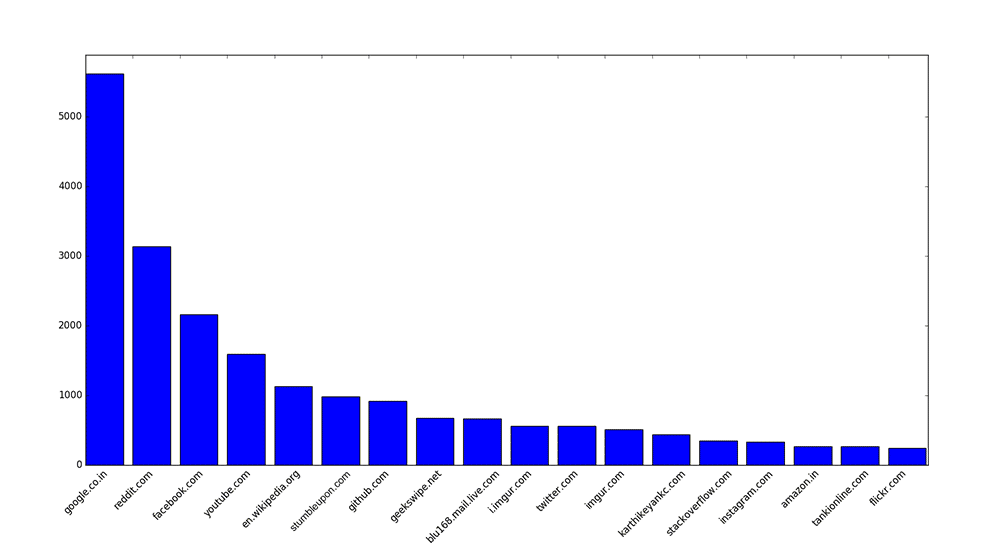

# HistoryAnalyzer
A Python script to grab some tasty data from your Chrome's history and analyze it.

## Screenshot


## Setup
```bash
python3 -m venv venv
source venv/bin/activate   # Windows: venv\Scripts\activate
pip install matplotlib
```

## Usage
Close Chrome first — it locks the history database while running.
 
```bash
python3 HistoryAnalyzer.py
```

The script copies your Chrome profile's `History` database to a temp folder, tallies visits per domain, and sorts them from most to least visited. You'll then be prompted to choose one of:
 
| Command | Description |
|---|---|
| `c` | Print the list to the console. |
| `p` | Show a horizontal bar chart of the list. |
| `s` | Save the full sorted list to `history_by_site.csv` in the current directory. |
 
## Notes
- No data leaves your machine.
- Chrome retains roughly 90 days of history (or ~10,000 entries).
- Only reads the current user's own Chrome profile.
- Works cross-platform: Windows, macOS, and Linux, using each OS's default Chrome profile location.
